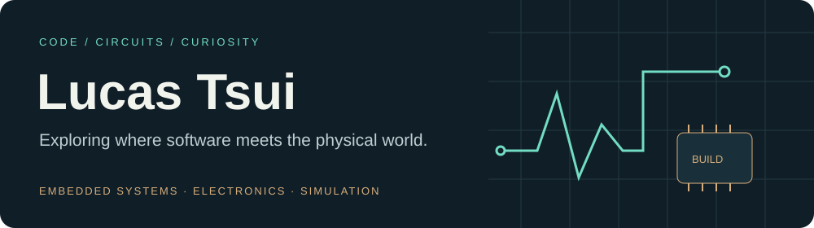
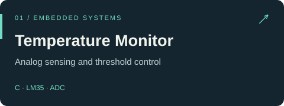
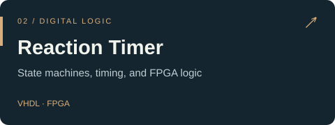
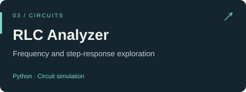
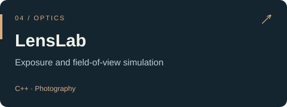
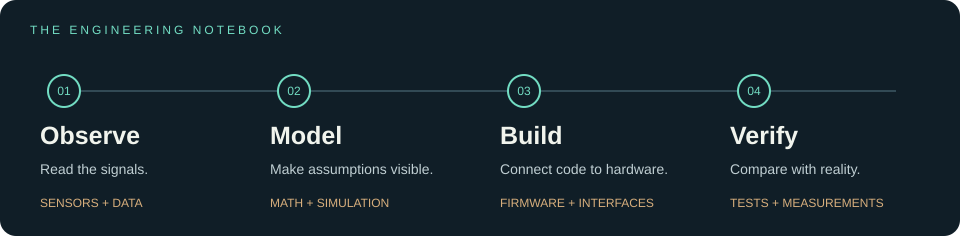

I build small systems to understand bigger ideas. My projects connect **embedded code, electronics, and simulation**—from FPGA timing logic to analog sensor processing.

### On the workbench

<table>
<tr>
<td width="50%"></td>
<td width="50%"></td>
</tr>
<tr>
<td></td>
<td></td>
</tr>
</table>

More experiments: [**MorsePulse**](https://github.com/2226442613/MorsePulse) · [**ARM Assembly Mini Toolkit**](https://github.com/2226442613/ARM-Assembly-Mini-Toolkit)

### My toolkit

**Languages** &nbsp; C · C++ · Python · VHDL · ARM Assembly  
**Hardware & control** &nbsp; ESP32 · Arduino · FPGA · Sensor interfaces  
**Development & simulation** &nbsp; Git · GitHub · Circuit analysis · Optical modeling

### From an idea to something that works

**Build → measure → understand → improve.**

I learn through experiments, keep the code readable, and document the difference between a working simulation and a tested physical system.

### Project notebook

The questions behind the projects matter as much as the code:

| Question | Where I explore it |
| :--- | :--- |
| How does a sensor reading become a control decision? | ADC conversion, temperature calculation, and threshold logic in **Temperature Monitor** |
| How do you make timing predictable? | Finite-state machines and millisecond timing in the **FPGA Reaction Timer** |
| How does a circuit respond to change? | Frequency and step responses in the **RLC Circuit Analyzer** |
| What connects camera settings to an image? | Exposure and field of view in **LensLab** |

### Pick a starting point

<table>
<tr>
<td width="33%" valign="top">
<b>Start close to the hardware</b>  
Explore memory, sensor readings, and control logic.  
<a href="https://github.com/2226442613/ARM-Assembly-Mini-Toolkit">ARM Assembly Mini Toolkit →</a> 
<a href="https://github.com/2226442613/Embedded-Temperature-Monitor-Project">Temperature Monitor →</a>
</td>
<td width="33%" valign="top">
<b>Make the invisible visible</b>  
Turn circuit behavior, light, and signals into something you can inspect.  
<a href="https://github.com/2226442613/RLC-Circuit-Analyzer">RLC Circuit Analyzer →</a> 
<a href="https://github.com/2226442613/LensLab">LensLab →</a>
</td>
<td width="33%" valign="top">
<b>Follow a system over time</b>  
Explore timing, state transitions, and feedback.  
<a href="https://github.com/2226442613/FPGA-Reaction-Timer-Game">FPGA Reaction Timer →</a> 
<a href="https://github.com/2226442613/MorsePulse">MorsePulse →</a>
</td>
</tr>
</table>

### Notes behind the builds

- **Small experiments first.** Isolate one behavior before connecting the whole system.
- **Visible assumptions.** Keep calibration, timing, and hardware requirements in the documentation.
- **Evidence over labels.** Separate simulated results, measured results, and unfinished work.

Have a question about a project? Open an issue in its repository so the discussion stays with the code.

---

[Explore my repositories →](https://github.com/2226442613?tab=repositories)
